# Riverside Town

A Roku screensaver inspired by Roku City. It shows a small town beside a river with mountains behind it. The scenery scrolls in layers at different speeds (parallax), cars drive along the street, and a panel shows the time, the temperature, and the current weather.

You can make your own town. The houses, shops, and other buildings, their names, colors, and fonts, the animals on the sidewalk, and the weather location all come from one file, `town.json`. See [Make your own town](#make-your-own-town).


## Seasons

| Spring | Summer |
|---|---|
| 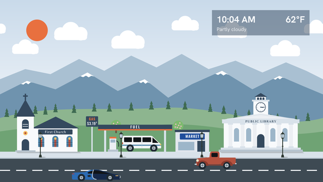 | 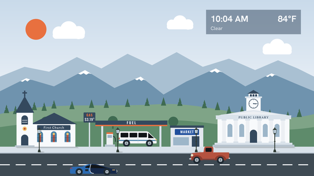 |
| **Fall** | **Winter** |
| 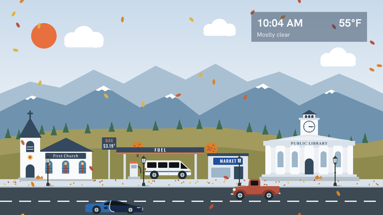 | 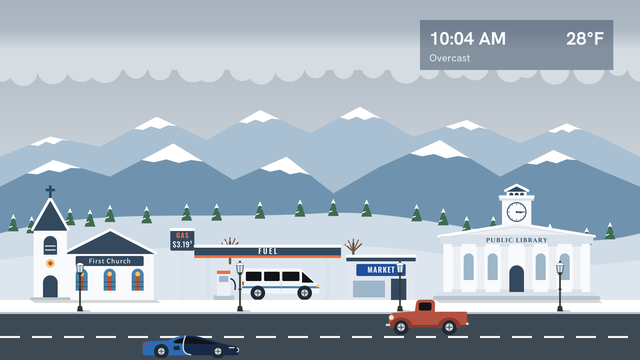 |

## Day, dusk, and night

| Day | Dusk | Night |
|---|---|---|
| 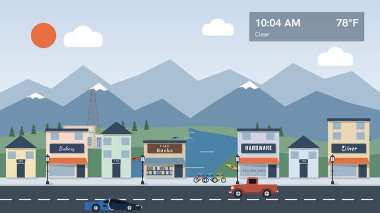 | 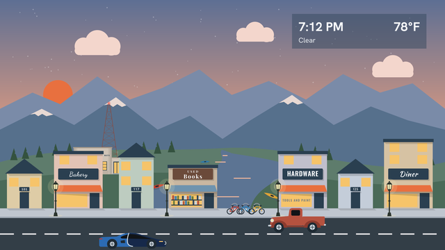 | 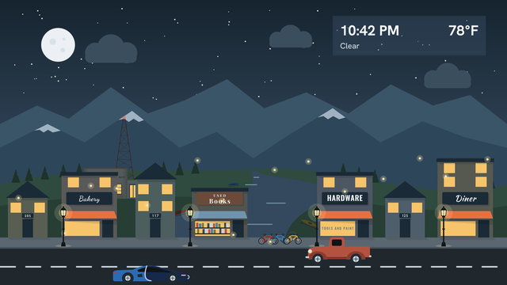 |

## December

| Early December, at dusk | A snowy night in December |
|---|---|
| 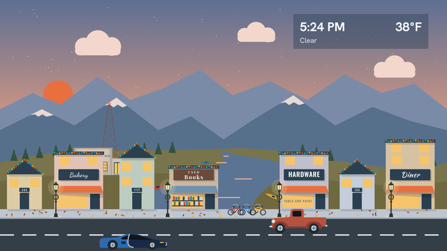 | 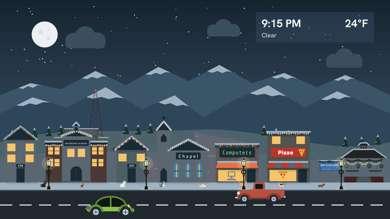 |

## The sample town

The `town.json` in this repository describes a sample town with four sections.


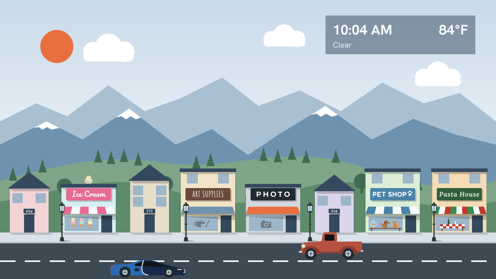

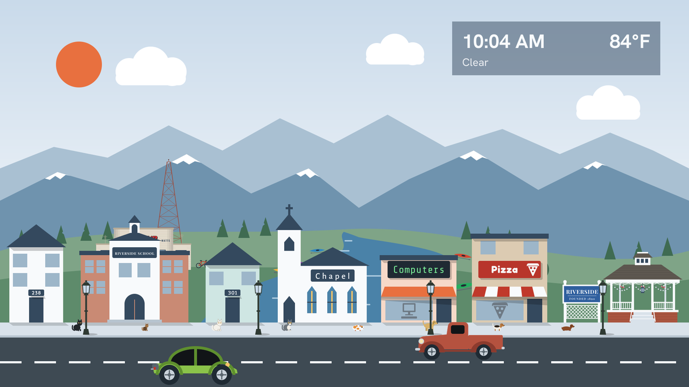

| Section D on a winter night |
|---|
| 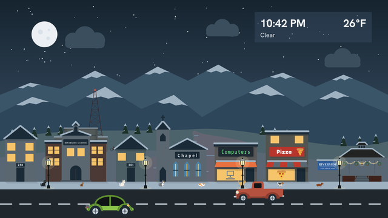 |

These images are drawn by `tools/generate_images.py` from the same artwork the screensaver uses. The animals are placed at random spots each time the screensaver starts, so they are in different places on the real screen.

## Features

- Five scenery layers that scroll at different speeds: clouds, far mountains, near mountains, hills with the river, and the town with the street. The far and near mountains each have two different images, so the mountains repeat only about every 13 minutes (far) and 5 minutes (near). As an option, the center far mountain can have a flat top, in the shape of Table Mountain in South Africa.
- A town of one to five sections, each 1920 pixels wide, built from the buildings in `town.json`. The buildings have different wall colors and heights, and each sign uses its own font. Like the rest of the scene, the colors are darker at dusk and night. Soft shadows under the awnings, roof edges, signs, and eaves, and on the sidewalk, give the buildings depth.
- A car parked at the gas station, if the town has one. The car and the direction it faces are chosen at random each time the screensaver starts.
- Six cars: a sports car in the style of a Bugatti, a sedan, a VW dune buggy with a green arch over the seats, a van, a Jeep, and an old truck. All cars have black windows. Each has its own speed, and the wheels spin at a rate that matches it. The sports car is the fastest. `town.json` can choose which cars drive by. It can also add special cars from movies: the Aston Martin DB5 from Goldfinger, Herbie (the Love Bug), KITT from Knight Rider, the Ecto-1 from Ghostbusters, the DeLorean time machine from the first Back to the Future movie, Lightning McQueen from Cars, and the 1969 Mustang Mach 1 from John Wick. Each special car has its own wheels. Special cars drive by less often than the other cars, about once every 1.5 to 4 minutes each, and never park at the gas station.
- As options: bikes in bike racks, two bikes parked beside the radio station, old-fashioned street lights that light up at dusk and night, and a radio station on the hill beside the river, with a tall red tower whose light blinks at dusk and night.
- Cats, dogs, and guinea pigs on the sidewalk, chosen in `town.json`. Cats come in five colors and two sizes, and there are eight kinds of dogs. They are placed at random spots each time the screensaver starts. The animals and the bikes go inside (are hidden) while it rains or snows. The bikes are also put away in winter.
- Two lanes. The near lane draws the cars at full size, and the far lane draws them slightly smaller. Cars drive on the right by default, so the near lane drives left to right and the far lane right to left. `drive_on` in `town.json` can make them drive on the left instead. Only one car uses a lane at a time, and after a car leaves the screen, its lane stays empty for a random 1 to 10 seconds.
- A small Cessna airplane flies across the sky about every 1 to 3 minutes, in either direction. It flies at the distance of the far mountains, so it is small and its speed matches that distance: it takes about 17 seconds to cross the screen. At dusk and night its wingtip light is on, green when it flies right and red when it flies left, as on a real plane (green is on the right wingtip and red on the left). A white tail light blinks. At night both lights are brighter, with a wider glow. It does not fly in rain, snow, fog, or thunderstorms.
- Weather from [Open-Meteo](https://open-meteo.com/), refreshed every 15 minutes, in Fahrenheit or Celsius. No API key is needed.
- A 12 hour or 24 hour clock.
- Day, dusk, and night versions of the scene, chosen from today's real sunrise and sunset times.
- Four seasons, chosen from today's date:

  | Season | Dates (northern hemisphere) | What changes |
  |---|---|---|
  | Spring | March 20 to June 20 | Light green hills, trees with pink blossoms, flower boxes under house windows |
  | Summer | June 21 to September 21 | Green hills and trees, fireflies at night |
  | Fall | September 22 to December 20 | Gold hills, orange and red trees, pumpkins by doors, leaves on the sidewalk, falling leaves |
  | Winter | December 21 to March 19 | Snow on the hills, mountains, roofs, sidewalk, and pine trees, bare trees, a frozen river |

  The dates are close to the equinoxes and solstices, which move by a day or so from year to year. In the southern hemisphere, the seasons are the other way around. Pine trees stay green all year. Some are plain triangles, and the others have one or two small notches cut into their sides, in four different patterns. There is one river, and in spring and summer, eight kayaks in different colors sit on the grass on both sides of it.
- Christmas decorations for all of December (in both hemispheres): strings of lights along the roofs of the houses, shops, churches, school, columned hall, gas station, and drive-through restaurant, a wreath on each street light, and garland on the gazebo, the town sign, and the columned hall. The gazebo also gets a wreath on each front post. Each building's lights are rainbow colored, all white, or red and white. At dusk and night the lights glow. On about one building in four, spread along the street, two thirds of the bulbs blink on and off at random; the lights on the other buildings stay on. The pumpkins are put away in December. The radio station and the scenery behind the town do not change. `extras.christmas` in `town.json` turns them off.
- Weather effects from the current weather:
  - Clouds: the number of clouds follows the cloud cover from the weather, in percent. Below 25 percent there are a few clouds, from 25 percent there are more, from 50 percent there are many larger clouds, and from 85 percent the sky is overcast: a gray layer of cloud covers the top of the sky with no separate clouds under it, the sky is gray, and the stars, the sun, and the moon are hidden. The weather code also sets the fewest clouds that can show, so the sky matches the text in the panel: "Partly cloudy" shows at least the second level, fog and showers at least the third, and "Overcast", drizzle, rain, snow, and thunderstorms show an overcast sky.
  - Rain and drizzle: falling rain.
  - Snow: falling snow. While snow is falling, the ground shows snow in any season.
  - Fog: a fog layer over the scene.
  - Thunderstorms: rain and lightning flashes at random times.

  Falling leaves and fireflies are hidden while rain or snow is falling. Leaves fall only in October and November (April and May in the southern hemisphere). Even then they do not fall all the time: they fall, fade out, stay hidden, then fade back in. Each of these lasts a random length of time.
- A banner plane for birthdays and messages. On a day with a birthday or a message, a larger copy of the airplane tows a banner with the text across the sky every 2 to 4 minutes. With more than one text, each flight shows the next one. It flies at the distance of the near mountains and takes about 20 to 30 seconds to cross the screen. Like the small airplane, it has its wingtip and tail lights at dusk and night, and it does not fly in rain, snow, fog, or thunderstorms. It flies even when `extras.airplane` is `false`.
- A theater building type with a marquee. The marquee shows today's birthdays and messages, one at a time, and the theater's own text when there are none. The letters are capital letters, sized to fit the board on one or two lines.
- An optional network settings file. Some settings, such as the airplane, the cars, and the units, can be changed from a JSON file on your home network or on the internet, without building the town again or installing it on the Roku again. See [Network settings file](#network-settings-file).
- A clock and weather panel in the top-right corner. Every 5 minutes it fades out, moves a small amount within the corner, and fades back in, to protect TVs from burn-in. The sun and moon are in the top-left corner, so the panel never covers them.

## Make your own town

There are three ways to build a town from your own `town.json`. All three give the same result: a zip file of the screensaver, which you install on your Roku (see [Installing on a Roku](#installing-on-a-roku)), and preview images of your town.

### With GitHub, in a web browser

This needs only a GitHub account.

1. Go to [rorpage/riverside-town-sample](https://github.com/rorpage/riverside-town-sample) and click **Use this template**, then **Create a new repository**.
2. In your new repository, open `town.json`, click the pencil icon to edit it, and change it to describe your town. The [town.json reference](#townjson-reference) below lists every field.
3. Click **Commit changes**. GitHub builds your town. This takes about a minute.
4. Open the **Actions** tab, click the latest run of **Build my town**, and look at the bottom of the page. There are two downloads:
   - **riverside-town-roku**: the screensaver. It downloads as `riverside-town-roku.zip`, which you upload to the Roku as it is. Do not unzip it.
   - **riverside-town-previews**: a zip file of preview images of your town.

If something in `town.json` is wrong, the run fails, and its log names the field and says what is wrong.

The workflow in the template repository uses the `rorpage/riverside-town@v1` action:

```yaml
- uses: rorpage/riverside-town@v1
  with:
    config: town.json
- uses: actions/upload-artifact@v4
  with:
    name: riverside-town-roku
    path: out/roku/
- uses: actions/upload-artifact@v4
  with:
    name: riverside-town-previews
    path: out/previews/
```

After the two uploads, the workflow deletes the downloads from earlier runs, so only the newest ones count against the storage space of your GitHub account. This step needs `actions: write` in the workflow's `permissions`. If a build fails, the downloads from the last build that passed are kept.

GitHub puts each download in a zip file. `out/roku/` holds the screensaver files without a zip, so the zip that GitHub makes has the manifest at the top level, which is what the Roku needs.

### With Docker

Run this in a folder that has a `town.json`:

```
docker run --rm -v "$PWD:/work" ghcr.io/rorpage/riverside-town-roku-generator:1
```

It writes `out/riverside-town.zip`, the same files without a zip in `out/roku`, and the preview images in `out/previews`.

### With Python

From the root of this repository:

```
pip install cairosvg pillow fonttools jsonschema
python3 tools/build_town.py --config path/to/town.json --out out
```

See [Changing the artwork](#changing-the-artwork) for the requirements.

### Business names

You can give a shop any name, including the name of a real business. Real business names and logos can be trademarks. A town with real business names is for your own personal use. Do not sell it or publish it as a product.

## town.json reference

`town.json` is a JSON file. `tools/riverside/town.schema.json` describes every field. Editors such as VS Code use it to suggest field names and point out mistakes while you type, if the first line of `town.json` is:

```json
"$schema": "https://raw.githubusercontent.com/rorpage/riverside-town/main/tools/riverside/town.schema.json",
```

Only `location` is required. The [town.json](town.json) in this repository is a complete example.

| Field | What it sets | Default |
|---|---|---|
| `title` | The screensaver name in Settings > Theme > Screensavers | `"Riverside Town"` |
| `location` | Where the weather comes from: `{ "zip": "46204", "country": "US" }`, or `{ "lat": 39.7684, "lon": -86.1581 }`. For a ZIP or postal code, the build looks up the coordinates. If both are given, the coordinates are used. | required |
| `units.temperature` | `"F"` or `"C"` | `"F"` |
| `units.clock` | `"12h"` or `"24h"` | `"12h"` |
| `hemisphere` | `"north"` or `"south"`. In the south, the seasons are the other way around. | `"north"` |
| `drive_on` | Which side of the road cars drive on: `"right"` (as in the United States) or `"left"` (as in the United Kingdom). With `"right"`, cars in the near lane drive from left to right; with `"left"`, from right to left. | `"right"` |
| `buildings` | The buildings along the street, from left to right. See below. | none |
| `houses` | House numbers to spread out between the buildings, for example `["12", "14", "16"]` | none |
| `radio_station` | A radio station on the hill beside the river, smaller than the town buildings, like the kayaks. It is a 1940s brick broadcast building with a rounded center, a wall of windows, a door on each side, and antennas, with a tall, thin red lattice tower behind its right side. The light on top of the tower blinks at dusk and night, like the airplane's tail light. The call letters are slanted red letters with a black outline and shadow. Like the WSQK logo, the first Q is drawn as an O with a lightning bolt for its tail. It is an object with `name` (the call letters, required), `small_line` (a line in script below them, for example `"The Squawk"`), `power` (shown as "50,000 WATTS" on each side of the call letters), `letter_color`, `color` (the brick), and `tower` (default `true`). | none |
| `pets` | Animals on the sidewalk, for example `{ "type": "cat", "color": "tabby", "size": "small" }`. Cats can be `"black"`, `"gray"` (dark gray with darker stripes, drawn a little darker at night so it shows against the sidewalk), `"tabby"`, `"white"`, or `"gray_white"` (gray with a white chest, muzzle, and paws). Dogs (`"dog"`) can be `"yellow_lab"`, `"black_lab"`, `"chocolate_lab"`, `"beagle"`, `"corgi"`, `"dalmatian"`, `"dachshund"`, or `"husky"`. Guinea pigs (`"guinea_pig"`) can be `"black_orange"` or `"white_orange"`. `size` is `"regular"` (the default) or `"small"`, which is 0.65 times as big. Up to 10. | none |
| `cars` | Which cars drive by: `"sedan"`, `"van"`, `"jeep"`, `"truck"`, `"sports"`, and `"buggy"`. At least 2. | all six |
| `special_cars` | Special cars from movies: `"aston"` (the silver Aston Martin DB5 from Goldfinger), `"herbie"` (Herbie, the Love Bug: a pearl white 1963 VW Beetle with the number 53 on the door), `"kitt"` (KITT from Knight Rider: a black 1982 Pontiac Trans Am with a red scanner light on the nose), `"ecto1"` (the Ecto-1 from Ghostbusters: a white and red 1959 Cadillac ambulance with equipment on the roof), `"delorean"` (the DeLorean time machine from the first Back to the Future movie), `"mcqueen"` (Lightning McQueen from Cars: a red race car with the number 95), and `"mustang"` (the dark gray 1969 Ford Mustang Mach 1 from John Wick). Each one first drives by 6 to 25 seconds after the screensaver starts, then about once every 20 seconds to 1 minute. Special cars never park at the gas station. | none |
| `external_config_url` | The address of a [network settings file](#network-settings-file), for example `"http://192.168.1.50:8080/riverside.json"`. Use `https`, or `http` for a server on your home network (a private IP address such as `192.168.x.x` or `10.x.x.x`, a name with no dots, or a name that ends in `.local`, `.lan`, `.home`, `.home.arpa`, or `.internal`). | `""` (none) |
| `birthdays` | Birthdays to show every year, for example `{ "name": "Sam", "date": "11-20" }`, which shows "Happy birthday, Sam!" on November 20. `date` is the month and day. `text` replaces the "Happy birthday" text. `where` is `"banner"`, `"marquee"`, or `"both"` (the default). A birthday on `"02-29"` shows on February 28 in years without February 29. Names can have up to 30 characters, and `text` up to 60. Up to 100. See [Birthdays and messages](#birthdays-and-messages). | none |
| `messages` | Texts to show between two dates, for example `{ "text": "Welcome home!", "from": "2026-12-20", "until": "2026-12-26" }`. Both dates are included. Without `from`, the text shows until `until`; without `until`, it shows every day from `from`. `where` works as in `birthdays`. Up to 60 characters each, and up to 50 messages. | none |
| `extras.airplane` | The airplane | `true` |
| `extras.kayaks` | The kayaks beside the river, in spring and summer | `true` |
| `extras.fireflies` | Fireflies on summer nights | `true` |
| `extras.falling_leaves` | Falling leaves in October and November (April and May in the southern hemisphere) | `true` |
| `extras.seasons` | Seasons from the date. When it is `false`, it is always summer, but snow still shows while it is snowing. | `true` |
| `extras.table_mountain` | A flat-topped mountain in the shape of Table Mountain, in the center of the far mountains | `false` |
| `extras.bikes` | Two bikes parked beside the radio station. Bike racks have bikes either way. All bikes are hidden in winter and while it rains or snows. | `false` |
| `extras.street_lights` | Old-fashioned cast iron street lights along the sidewalk, about 480 pixels apart. A light moves to the side when it would cover a house number. Animals walk behind the lights. Their lanterns light up at dusk and night. | `false` |
| `extras.christmas` | Christmas decorations in December: lights along the roofs of the buildings in town, a wreath on each street light, and garland on the gazebo, the town sign, and the columned hall. The lights glow at dusk and night. On about one building in four, most of the bulbs blink at random. | `true` |
| `extras.christmas_lights` | The style of the Christmas lights: `"rainbow"`, `"white"`, `"red_white"`, or `"mixed"`, where each building gets one of the three styles, never the same style as the building with lights before it. | `"mixed"` |

### Buildings

Each entry in `buildings` is a building with a `type`. A house can also be written as just its number, for example `"101"`.

The buildings are placed in order, with a space of at least 28 pixels between them (12 pixels if 28 would need another section), and the room that is left in a section is shared out between the spaces, so more of the hills and the river shows between the buildings. When the next building does not fit in the current 1920 pixel section, it starts the next section. `{ "type": "section_break" }` starts a new section on purpose. To spread out the buildings in a full section, move a `section_break` so some of its buildings go to a section with more room. Up to 3 trees, in different sizes, stand in the space left at the end of a section. The town can have up to 5 sections, because each section uses about 4 MB of memory on the Roku. If the buildings do not fit, the build stops and says how many to remove.

These options work for most types:

| Option | What it sets |
|---|---|
| `name` | The name on the sign. Long names are made smaller to fit. A straight apostrophe (`'`) is drawn as a curly one. |
| `color` | The wall color, as `"#RRGGBB"`, in daylight. It is darker at dusk and night. Without it, the building gets a color from a set of colors that look good together. |
| `font` and `weight` | The font for the sign, from the [font list](#fonts), and its weight from 100 (thin) to 900 (black). Fonts with one weight ignore `weight`. |
| `sign_size` | The largest text size on the sign |

| Type | What it is | Its own options |
|---|---|---|
| `house` | A house with a pointed roof and its number above the door | `number` (required), `stories` (1 or 2), `width` (110 to 260 pixels, default 150). Without a `font`, each house gets a different one. |
| `shop` | A shop with a sign, an awning, and a display window | `stories` (1, 2, or 3), `width` (160 to 400, default 210), `small_line` (a small line above the name), `sign_color`, `sign_text_color`, `sign_icon` (`"paw"` or `"pizza"`, a slice of pizza), `letter_spacing`, `awning` (`"plain"`, `"striped"`, or `"none"`), `awning_color`, `awning_colors` (2 to 4 stripe colors), `window`, `window_lettering` (gray letters on the window; `\n` starts a second line), `roof_icon` (`"ice_cream"`) |
| `bakery`, `bookstore`, `diner`, `computer_store`, `ice_cream`, `art_store`, `photo_store`, `pet_shop`, `pizza_shop`, `restaurant` | A shop with a font, colors, and window already chosen. Any shop option changes them. `pizza_shop` has a slice of pizza icon in the window and on the sign; set its `name` to the name you want. | the shop options |
| `church` | A church | `style` (`"steeple"`: a bell tower with a spire; `"tower"`: a stone church with a square tower), `cross` (default `true`) |
| `school` | A two-story school with the name over the door | `cross`, `bell_tower`, `width` (240 to 480, default 300) |
| `columned_hall` | A stone building with columns and steps, like a library, a courthouse, or a university, with the name across the top. The building always has the stone colors of the town; its `color` is not used. A town can have more than one, each with its own name and lettering colors. | `clock` (a clock tower), `clock_time` (for example `"10:04"`), `letter_color` (the color of the name; default: the roof color), `letter_outline` (a 2 pixel outline around each letter; default: none) |
| `gas_station` | A price sign, a canopy over one pump, and a small store. A car is parked under the canopy. | `canopy_name` (default `"FUEL STOP"`), `store_name` (default `"MARKET"`), `store_sign_color`, `price` (for example `"3.19"`; a small 9 is added for the 9/10 of a cent) |
| `drive_through` | A restaurant with its name on a colored roof and a drive-through window | `roof_color`, `sign_text_color` |
| `theater` | A two-story movie theater with its name on a sign, a marquee with a row of bulbs along its top and bottom, glass doors, and a poster case on each side. The marquee board and bulbs are lit at dusk and night. The marquee shows today's [birthdays and messages](#birthdays-and-messages), and `text` when there are none. | `text` (up to 60 characters, shown in capital letters; default `"WELCOME"`), `width` (300 to 440, default 360), `sign_color`, `sign_text_color`, `trim_color` (the marquee trim and the poster cases) |
| `gazebo` | An eight-sided gazebo on a brick base, with a shingled roof, a cupola, white posts and railings, and front steps. It is open inside, so the hills show between the posts. It has hanging flower baskets in spring and summer, leaf garlands, corn stalks, hay, and pumpkins in fall, and wreaths in winter. Strings of bulbs hang between the posts, with a lantern in the middle, and they are lit at dusk and night. | `name` (a town sign stands to its left, with this name), `small_line` (a small line on the sign, for example `"FOUNDED \u00b7 1779"`), `sign_color`, `color` (the brick base) |
| `bike_rack` | A bike rack on the sidewalk with three bikes (the bikes are hidden in winter and while it rains or snows) | none |
| `tree` | A tree | none |
| `section_break` | Starts a new town section | none |

A columned hall can show a university that someone in the family went to, in the university's colors. Add one for each university:

```json
{ "type": "columned_hall", "name": "NORTH STATE", "font": "graduate", "weight": 400, "letter_color": "#C8102E", "letter_outline": "#FFFFFF" },
{ "type": "columned_hall", "name": "LAKESIDE COLLEGE", "font": "cinzel", "weight": 700, "letter_color": "#FFB81C", "letter_outline": "#003A70" }
```

The lettering colors are the same at all times of day, like the colors of the store signs.

`window` choices for shops: `"books"` (rows of book spines), `"computer"`, `"camera"`, `"palette"` (a painter's palette), `"ice_cream"` (three cones), `"pets"` (a fish bowl, a puppy, and a kitten on a table), `"table"` (a table with a checkered tablecloth), `"pizza"` (a slice of pizza), or `"none"`.

### Fonts

The `font` value is one of these names:

| Name | Font | Name | Font |
|---|---|---|---|
| `alegreya` | Alegreya Sans (Medium only) | `kaushan` | Kaushan Script (one weight) |
| `amatic` | Amatic SC (Bold only) | `lora` | Lora Italic |
| `bitter` | Bitter | `montserrat` | Montserrat |
| `cabin` | Cabin | `oswald` | Oswald |
| `cinzel` | Cinzel | `pacifico` | Pacifico (one weight) |
| `comfortaa` | Comfortaa | `playfair` | Playfair Display |
| `fredoka` | Fredoka | `quicksand` | Quicksand |
| `graduate` | Graduate (one weight) | `raleway` | Raleway |
| `hanken` | Hanken Grotesk | `script` | Dancing Script |
| `josefin` | Josefin Sans | `racing` | Racing Sans One (one weight; the radio station call letters) |
| `sharetech` | Share Tech Mono (one weight) | `signika` | Signika |

If a font cannot draw a letter in a name, the build stops and names the letter.

These fonts are from [Google Fonts](https://fonts.google.com/), under the SIL Open Font License. The license for each font is in `tools/fonts` next to the font file. The fonts are used only by the generator and are not part of the Roku zip.

## Network settings file

`external_config_url` in `town.json` can point to a JSON file that changes some settings while the screensaver runs. Changing the file does not need a new build or a new install on the Roku.

The settings are applied in three layers:

1. The defaults in `loadTownConfig()` in `components/MainScene.brs`.
2. `components/town_config.json` in the zip, made from `town.json`.
3. The network settings file. Each value in it replaces the value from the zip.

The rules:

- A field that is not in the file keeps its value from the zip. Every new copy of the file is applied to the settings from the zip again, not to the settings from the copy before it. So when you remove a field from the file, that setting goes back to its value in the zip.
- A list in the file (`cars` or `special_cars`) replaces the whole list from the zip.
- A value with the wrong type, or a value that is not allowed, is skipped, and the value from the zip is used. The reason is printed in the [debug console](#debugging).
- The screensaver starts with the settings from the zip, downloads the file, and applies it. After that it downloads the file again every `refresh_minutes`.

The fields use the same names as in `town.json`. All of them are optional:

```json
{
  "version": 1,
  "refresh_minutes": 10,
  "extras": { "airplane": false, "fireflies": true, "falling_leaves": true, "seasons": true },
  "units": { "temperature": "C", "clock": "24h" },
  "location": { "lat": 39.7684, "lon": -86.1581 },
  "cars": ["sedan", "van", "jeep"],
  "special_cars": ["herbie"],
  "birthdays": [{ "name": "Sam", "date": "11-20" }],
  "messages": [{ "text": "Welcome home!", "from": "2026-12-20", "until": "2026-12-26", "where": "marquee" }]
}
```

Editors such as VS Code check the file while you type if it starts with:

```json
"$schema": "https://raw.githubusercontent.com/rorpage/riverside-town/main/tools/riverside/external.schema.json",
```

| Field | What it sets |
|---|---|
| `version` | The version of this file format. Use `1`. The screensaver does not use a file with a higher version. |
| `refresh_minutes` | Minutes between downloads, from 1 to 1440. The default is 10. |
| `extras.airplane`, `extras.fireflies`, `extras.falling_leaves`, `extras.seasons` | The same as in `town.json`: `true` or `false`. A plane that is already in the air finishes its flight. |
| `units.temperature`, `units.clock` | The same as in `town.json`. A new temperature unit downloads the weather again. |
| `location` | `lat` and `lon`, as numbers or as text. Both are needed. A ZIP code does not work here, because the coordinates for a ZIP code are looked up when the town is built. |
| `cars` | Which of the six regular cars drive by. At least 2. A car that is turned off finishes its trip. |
| `special_cars` | Which special cars drive by. All special cars are in every zip, so any of them can be turned on here. |
| `birthdays`, `messages` | The same as in `town.json`. Each list replaces the whole list from `town.json`. An entry with a mistake is skipped, and the other entries are used. |

Settings that change the images can only be set in `town.json`: the buildings, the sections, the radio station, the animals, the street lights, the hemisphere, the side of the road, the Christmas decorations, and the other extras. The car parked at the gas station is chosen when the screensaver starts, from the cars in the zip.

To check a file for mistakes before the screensaver uses it:

```
python3 tools/check_external_config.py riverside.json
```

It needs only the jsonschema package (`pip install jsonschema`). The [companion](companion/) folder has a Docker Compose file that serves the file on your home network with nginx, and the steps to set it up.

### When the file cannot be downloaded

The screensaver saves the last good copy of the file on the Roku. A good copy is one that downloads with response code 200 and is valid JSON.

- When the server cannot be reached, or the file is not valid JSON, the screensaver keeps using the last good copy. This also works when the screensaver starts again, so a server that is down does not change what you see.
- The last good copy is used for up to 7 days after it was downloaded (`m.externalKeepDays` in `components/MainScene.brs`). After that, the settings from the zip are used until the file can be downloaded again.
- The saved copy is only used for the same address. If you change `external_config_url` in `town.json`, a copy from the old address is not used.
- Files larger than 12,000 characters are used but not saved, because Roku gives each app only 16 KB of storage for this.

To go back to the settings in the zip:

- For some settings: remove those fields from the file. The change shows at the next download.
- For all settings: delete the file, or replace its contents with `{}`. When the server answers that the file does not exist (response code 404 or 410), the screensaver also deletes the saved copy, so the zip settings stay in use even if the server is down later.
- For good: remove `external_config_url` from `town.json`, then build and install the town again.

### Birthdays and messages

`birthdays` and `messages` can be set in `town.json`, in the network settings file, or both. The screensaver works out today's texts from the Roku's date and time zone, birthdays first, then messages, in the order they are listed.

Texts with `"where": "banner"` or `"both"` are shown on the banner plane. The first flight is 15 to 45 seconds after the screensaver starts, and the next ones are 2 to 4 minutes apart. The banner gets wider to fit the text. A new birthday or message from the network settings file shows on the next flight.

Texts with `"where": "marquee"` or `"both"` are shown on the marquee of every `theater` in the town. Each text stays for 12 seconds, then the letters fade out and the next text fades in. With one text, it stays. When there is no text for today, each theater shows its own `text`. The text is shown in capital letters, in the largest of five sizes at which it fits the board, on one or two lines. A word that is too long for the board at the smallest size is cut off with "...". The previews show each theater's own `text`.

The banner and the marquees use Oswald Bold. The generator writes it to `components/fonts/Oswald-Bold.ttf`, with its license, from `tools/fonts/Oswald-Variable.ttf`. A birthday or message in `town.json` with a letter that Oswald cannot draw stops the build with a message. The network settings file is not checked for this, so such a letter shows as an empty box on the TV. Oswald has the Latin and Cyrillic alphabets, but not Greek letters or emoji.

Today's texts are also printed in the [debug console](#debugging) with the prefix `Messages today:` when the screensaver starts and after each download of the network settings file.

## Project layout

```
manifest                         Roku channel manifest (the generator writes the title)
town.json                        The sample town
build.sh                         Builds riverside-town.zip and installs it on a Roku
source/main.brs                  Entry point (RunScreenSaver)
components/MainScene.xml         Scene layout: layers, lanes, panel, animations
components/MainScene.brs         init(), the settings, and small helpers for the scene
components/scene/                The rest of the scene logic, one file for each part: scenery and time of day,
                                 Christmas, weather, airplane, clock panel, cars, sidewalk (animals and lamps),
                                 the network settings file, today's birthdays and messages, the banner plane,
                                 and the theater marquees
components/WeatherTask.xml       Task node definition for the weather request
components/WeatherTask.brs       Calls the Open-Meteo API
components/ExternalConfigTask.*  Downloads the network settings file and keeps the last good copy
companion/                       Docker Compose file and an example network settings file
components/town_config.json      The town's settings for the screensaver, written by the generator
components/fonts/                Oswald Bold and its license, for the banner and the marquees, written by the generator
images/                          All artwork as PNG files, written by the generator
tools/generate_images.py         Draws every image in images/ from town.json
tools/build_town.py              Builds a complete zip and previews from any town.json (used by Docker)
tools/check_external_config.py   Checks a network settings file for mistakes
tools/riverside/                 The generator's code: building types, layout, scenery, town.schema.json,
                                 and external.schema.json (the network settings file)
tools/fonts/                     Sign fonts and their licenses (used only by the generator)
Dockerfile                       The riverside-town-roku-generator image
action.yml                       The GitHub Action that runs the image
.github/workflows/               Publishes the image when a version tag is pushed
docs/                            Preview images for this README, and customization-plan.md (not part of the Roku zip)
```

## Installing on a Roku

1. Turn on developer mode on the Roku. On the remote, press Home 3 times, Up 2 times, then Right, Left, Right, Left, Right. Follow the steps on screen and set a password.
2. Install the zip. There are two ways:
   - **Install with the web page.** In a web browser, go to `http://<roku-ip-address>`, sign in with the username `rokudev` and your password, and upload the zip file (`riverside-town.zip`, or `riverside-town-roku.zip` from GitHub).
   - **Install from the script.** To install the sample town in this repository, run this from the repository root, with the Roku's IP address:
     ```
     ROKU_DEV_TARGET=<roku-ip-address> ./build.sh
     ```
     The script checks that the Roku responds, builds `riverside-town.zip`, asks for the developer password, and uploads the zip to the Roku. Run `./build.sh --zip-only` to only build the zip. If you cannot run the script, run this from the repository root instead:
     ```
     zip -r riverside-town.zip manifest source components images -x "*.DS_Store"
     ```
   Either way, the zip contains only the files the Roku needs, with the manifest at the top level.
3. On the Roku, go to Settings > Theme > Screensavers and choose Riverside Town (or the `title` from your `town.json`).

Because a screensaver cannot be opened from the home screen, use the Preview option in Settings > Theme > Screensavers to see it without waiting for the Roku to go idle.

Developer mode allows only one sideloaded channel at a time. Installing this screensaver replaces any other sideloaded channel on the same Roku.

## Settings in the code

The settings that are not in `town.json` are at the top of `init()` in `components/MainScene.brs`.

| Setting | What it controls |
|---|---|
| `m.layerSpeeds` | Scroll speed of each scenery layer, in pixels per second. |
| `m.layerWidths` | Width of each scenery layer before it repeats. The far and near mountains are 3840 because each is two different 1920 pixel images. The hills are 5760 because they are three. The town is 1920 times the number of town sections. |
| `m.cameraSpeed` | Must match the `town` layer speed. Cars use it so their speed looks correct relative to the street. |
| `allCars` | Each car's image size, wheel positions, wheel radius, and `ground` speed in pixels per second. `m.carDefs` holds the ones `town.json` turns on. |
| `m.planeSpeed` | The airplane's own speed at the distance of the far mountains, in pixels per second. The comment above it in `MainScene.brs` shows how it was worked out. |
| `m.planeWaitMin`, `m.planeWaitMore` | Seconds between airplane flights: at least `m.planeWaitMin`, plus a random amount up to `m.planeWaitMore`. |
| `m.bannerSpeed` | The banner plane's own speed at the distance of the near mountains, in pixels per second. The comment above it in `MainScene.brs` shows how it was worked out. |
| `m.bannerFirstMin`, `m.bannerFirstMore`, `m.bannerWaitMin`, `m.bannerWaitMore` | Seconds before the first banner flight (15 to 45 by default) and between flights (120 to 240 by default): at least the `Min` value, plus a random amount up to the `More` value. |
| `m.marqueeHold` | Seconds each text stays on a theater marquee before the next one. The default is 12. |
| `m.leafOnMin`, `m.leafOnMore`, `m.leafOffMin`, `m.leafOffMore` | How long the fall leaves fall and how long they stop, in seconds: at least the `Min` value, plus a random amount up to the `More` value. The defaults are 25 to 70 seconds falling and 15 to 60 seconds stopped. |
| `m.externalKeepDays` | Days to keep using the last good network settings file when it cannot be downloaded. The default is 7. |
| `m.externalRefreshDefault` | Minutes between downloads of the network settings file when the file has no `refresh_minutes`. The default is 10. |
| `m.infoSpots` | The positions the clock panel moves between. They are all in the top-right corner. |
| `m.seasonOverride` | Set to `"spring"`, `"summer"`, `"fall"`, or `"winter"` to always show that season, for example to preview it. Leave it as `""` to choose the season from the date. |
| `m.christmasOverride` | Set to `"on"` to always show the Christmas decorations, or `"off"` to never show them. Leave it as `""` to show them in December. It does nothing when `extras.christmas` is `false`, because the town then has no Christmas images. |
| `m.seasonalLayers` | Which scenery layers have a different image for some seasons. It must match `SEASONAL` in `tools/generate_images.py`. |

The panel's transparency is set by the `color` value on the `Rectangle` inside the `info` group in `components/MainScene.xml`. The last two characters are the opacity: `00` is fully clear and `FF` is fully solid.

## Changing the artwork

The images are drawn by `tools/generate_images.py` and the code in `tools/riverside/`. Edit `town.json`, or the shapes and colors in the code, then regenerate:

```
pip install cairosvg pillow fonttools jsonschema
python3 tools/generate_images.py --docs docs
```

Requirements:

- Python 3.
- The Cairo graphics library, which `cairosvg` needs. On macOS, install it with `brew install cairo`. On Debian or Ubuntu, install it with `sudo apt install libcairo2`.
- No fonts need to be installed. The sign fonts are in `tools/fonts`, and the generator converts the sign text to shapes, so the images are the same on every computer.
- An internet connection only if `town.json` has a ZIP code without coordinates.

The generator writes:

- every PNG into `images/`, including the mirrored car images used by the far lane
- `components/town_config.json`, the settings the screensaver reads: the coordinates, units, number of town sections, cars, animals, extras, and where the gas station is
- the title into `manifest`
- full-scene previews into `build/`, which git ignores: one for each town section, season, and day and night (`composite_<season>_<period>_<section>.png`). The summer previews include the parked car so its position can be checked. With `extras.christmas` on, there are also previews of the Christmas decorations in fall and winter, by day and at dusk (`composite_christmas_<season>_<period>_<section>.png`).
- the preview images for this README into `docs/`, when `--docs docs` is given

Where each part of the drawing is:

| File | What it draws |
|---|---|
| `tools/riverside/art.py` | Palettes, season colors, fonts and text, and small details such as snow, pumpkins, flower boxes, and trees |
| `tools/riverside/scenery.py` | The sky, clouds, mountains, hills, river, and street |
| `tools/riverside/buildings.py` | Every building type |
| `tools/riverside/layout.py` | Places the buildings in town sections |
| `tools/riverside/config.py` | Reads and checks `town.json`, and fills in defaults |
| `tools/riverside/sprites.py` | The cars, animals, airplane, sun, moon, stars, and weather effects |
| `tools/riverside/movie_cars.py` | The special cars from movies and their wheels |
| `tools/riverside/previews.py` | The preview images |

Notes on the image sizes:

- Each scenery layer is exactly 1920 pixels wide and its left and right edges line up, so two copies placed side by side repeat without a visible seam. The town layer is one image for each town section (`town_a` to `town_e`). The screensaver places them in order, then the first one again, so the street repeats without a jump.
- The sky is an 8 pixel wide gradient that the scene stretches to full width. This uses much less memory than a full-size image. The fog image works the same way.
- The hills are three different images, `hills`, `hills_b`, and `hills_c`, placed in the order A, B, C, A, so they repeat every 5760 pixels. Only the first has the radio station. The third has its own hill shapes, more trees, and no river.
- Seasonal layers are named `<layer>_<season>_<period>.png`, for example `hills_fall_night.png`. The hills and the town sections have an image for every season. The far and near mountains only have a winter image (`far_winter_day.png`); in other seasons they use the image without a season in the name (`far_day.png`). The clouds and sky do not change with the seasons. The clouds have one image for each cloud level, named `clouds_<level>_<period>.png` (`few`, `scattered`, `broken`, and `overcast`), and the overcast sky is `sky_overcast_<period>.png`.
- The generator deletes the old images before it writes new ones, so files that are no longer used do not stay in `images/`.

## Adding features and releasing

New features are made in this repository. Other towns get them when a new version is published.

### 1. Make the change

Make the change on a branch named `feature/<short-name>`, open a pull request, and merge it into `main`. If the feature adds a `town.json` field or option, also:

- add it to `tools/riverside/town.schema.json`
- add its default to `tools/riverside/config.py`
- add it to the [town.json reference](#townjson-reference) in this README
- regenerate the previews with `python3 tools/generate_images.py --docs docs`

### 2. Test it before publishing

The GitHub Action always runs the published Docker image, not the code on a branch, so a branch cannot be tested with the "Build my town" workflow. Test it on your computer instead, with any `town.json`:

```
python3 tools/build_town.py --config path/to/town.json --out out
```

This builds the same zip that the Action builds, in `out/riverside-town.zip`. Install it with the Roku developer web page (see [Installing on a Roku](#installing-on-a-roku)).

### 3. Publish a new version

After the pull request is merged, push a version tag from `main`:

```
git checkout main
git pull
git tag v1.1.0
git push origin v1.1.0
```

You can also create a release on GitHub instead: on the **Releases** page, click **Draft a new release**, type the new tag, choose `main` as the target, and click **Publish release**.

Choose the version number from the kind of change:

| Kind of change | Example | Tag |
|---|---|---|
| A fix that changes nothing for users | a drawing mistake | `v1.0.1` |
| A new feature that existing `town.json` files do not need | a new building type or a new pet | `v1.1.0` |
| A change that makes existing `town.json` files fail | a field is renamed or removed | `v2.0.0` |

The tag starts `.github/workflows/riverside-town-roku-generator.yml`. It builds the Docker image and publishes it to the GitHub Container Registry as `ghcr.io/rorpage/riverside-town-roku-generator`, with the tags `1.1.0`, `1.1`, `1`, and `latest`. Then it moves the git tag `v1` to the same commit. The next "Build my town" run in any repository that uses `rorpage/riverside-town@v1` uses the new version, with no change in that repository.

For a new major version, such as `v2.0.0`, first change the image in `action.yml` from `:1` to `:2` in the pull request. The workflow then creates the `v2` tag. Repositories that use `@v1` keep the old version until their workflow is changed to `@v2` and their `town.json` is updated.

The image package must be public, so that anyone can download it without signing in. This is set once, in the package settings on GitHub, and stays set for new versions.

### 4. Rebuild the towns

- If the new feature needs settings, add them to the town's `town.json`. Committing the change starts a build.
- If it needs no settings, open **Actions**, then **Build my town**, then **Run workflow**, to rebuild with the new version.
- Keep the `town.json` in [riverside-town-sample](https://github.com/rorpage/riverside-town-sample) the same as the one in this repository, except that the sample repository uses a ZIP code, so the template shows the new features.

## Debugging

Connect to the screensaver's debug console with:

```
telnet <roku-ip-address> 8087
```

Screensavers use port 8087, not port 8085 like normal channels. Errors from the weather request are printed there with the prefix `WeatherTask:`. If `components/town_config.json` cannot be read, a message is printed with the prefix `MainScene:`, and the screensaver uses default settings. Messages about the network settings file start with `External settings:` or `ExternalConfigTask:`.

## Known limits

- A screensaver cannot define `Main()`. If it does, Roku does not list it under Settings > Theme > Screensavers. For this reason it cannot be opened from the home screen.
- Only one car uses each lane at a time, so at most two moving cars are on screen.
- Dusk covers 40 minutes on each side of sunrise and sunset. Before the first weather request finishes, the scene assumes sunrise at 7:00 AM and sunset at 7:00 PM.
- New building types and new animals need Python code in the generator. `town.json` can only choose from the types that exist.

## License

The code and artwork in this repository are released into the public domain under [The Unlicense](LICENSE). You can copy, change, and share them for any purpose, without asking.

The fonts in `tools/fonts` are not covered by this license. Each font has its own license file next to it, the SIL Open Font License, which allows using and sharing the fonts.

## Credits

Weather data is provided by [Open-Meteo](https://open-meteo.com/). The free Open-Meteo API is for non-commercial use and its data requires attribution. Check the Open-Meteo terms before using this project for anything commercial.
