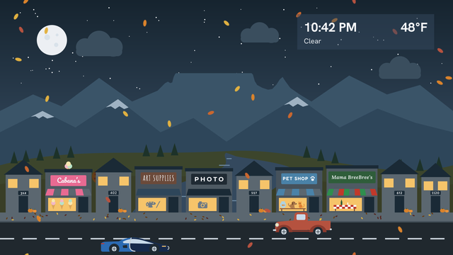
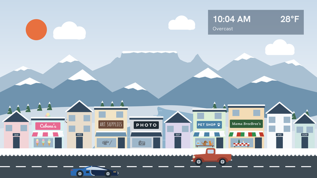
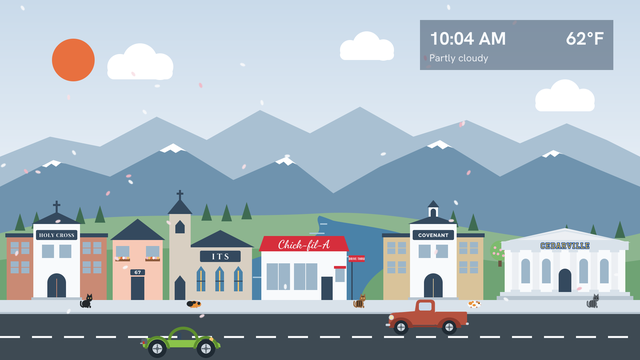

# Riverside Town

A Roku screensaver inspired by Roku City. It shows a small town beside a river with mountains behind it. The scenery scrolls in layers at different speeds (parallax), cars drive along the street, and a panel shows the time, the temperature, and the current weather.


## Seasons

| Spring | Summer |
|---|---|
|  |  |
| **Fall** | **Winter** |
|  |  |

## Day, dusk, and night

| Day | Dusk | Night |
|---|---|---|
|  |  |  |

## The third block


| Fall night | Winter day |
|---|---|
|  |  |

## The fourth block


| Winter night | Spring day |
|---|---|
|  |  |

These images are drawn by `tools/generate_images.py` from the same artwork the screensaver uses. The cats and guinea pigs are placed at random spots each time the screensaver starts, so they are in different places on the real screen.

## Features

- Five scenery layers that scroll at different speeds: clouds, far mountains, near mountains, hills with the river, and the town with the street. The far and near mountains each have two different images, so the mountains repeat only about every 13 minutes (far) and 5 minutes (near). The center far mountain has a flat top, in the shape of Table Mountain in South Africa.
- The houses and shops have different wall colors. The houses are yellow, green, blue, pink, tan, lavender, mint, and white. The shops use soft colors such as peach, cream, aqua, and light green. Like the rest of the scene, the colors are darker at dusk and night.
- The town has four sections. The buildings are different heights: some houses and shops have two or three floors. The first has three houses (numbered 5401, 135, and 5334), a donut shop called Long's Donuts, a book store called Forever Books, a computer store called E-gineering, and a diner called Luke's. Luke's is a reference to Gilmore Girls: in the show, the diner is in the old Williams Hardware building, so "Williams Hardware" is lettered in gray on its window. The second has a church named New City, a gas station with a small Kroger store, and the Hill Valley Courthouse Mall from Back to the Future, with its clock stopped at 10:04. The third has five more houses (numbered 312, 402, 527, 612, and 1120), an ice cream shop called Cabana's, an art supply store with a small painter's palette icon in the window, a photography store with a small camera icon in the window, a pet shop with a fish bowl, a puppy, and a kitten on a table in the window, and an Italian restaurant called Mama BreeBree's. The fourth has Holy Cross school, a house numbered 67, a church named ITS, a Chick-fil-A with a drive-through window, Covenant school, and Cedarville, a university building with columns and its name in blue and yellow letters in a college letterman style.
- A car is parked at the gas station. The car and the direction it faces are chosen at random each time the screensaver starts.
- Each store sign uses its own font.
- Six cars: a sports car in the style of a Bugatti, a sedan, a VW dune buggy with a green arch over the seats, a van, a Jeep, and an old truck. Each has its own speed, and the wheels spin at a rate that matches it. The sports car is the fastest.
- Three cats (black, a dark gray cat with darker gray stripes, and a brown and black striped tabby) and two guinea pigs (one black and orange, one white with orange spots) sit on the sidewalk. They are placed at random spots each time the screensaver starts.
- Two lanes. The near lane drives left to right at full size. The far lane drives right to left and draws the cars slightly smaller.
- A small Cessna airplane flies across the sky now and then, about every 1 to 3 minutes, in either direction. It flies at the distance of the far mountains, so it is small and its speed matches that distance: it takes about 17 seconds to cross the screen. At dusk and night its wingtip light is on, green when it flies right and red when it flies left, as on a real plane (green is on the right wingtip and red on the left). A white tail light blinks. At night both lights are brighter, with a wider glow. It does not fly in rain, snow, fog, or thunderstorms.
- Weather from [Open-Meteo](https://open-meteo.com/), refreshed every 15 minutes. No API key is needed.
- Day, dusk, and night versions of the scene, chosen from today's real sunrise and sunset times.
- Four seasons, chosen from today's date:

  | Season | Dates | What changes |
  |---|---|---|
  | Spring | March 20 to June 20 | Light green hills, trees with pink blossoms, flower boxes under house windows, falling petals |
  | Summer | June 21 to September 21 | Green hills and trees, fireflies at night |
  | Fall | September 22 to December 20 | Gold hills, orange and red trees, pumpkins by doors, leaves on the sidewalk, falling leaves |
  | Winter | December 21 to March 19 | Snow on the hills, mountains, roofs, sidewalk, and pine trees, bare trees, a snowbank along the curb, a frozen river |

  The dates are close to the equinoxes and solstices, which move by a day or so from year to year. Pine trees stay green all year.
- Weather effects from the current weather:
  - Rain and drizzle: falling rain.
  - Snow: falling snow. While snow is falling, the ground shows snow in any season.
  - Fog: a fog layer over the scene.
  - Thunderstorms: rain and lightning flashes at random times.

  Falling leaves, petals, and fireflies are hidden while rain or snow is falling.
- A clock and weather panel in the top-right corner. Every 5 minutes it moves a small amount within the corner to protect TVs from burn-in. The sun and moon are in the top-left corner, so the panel never covers them.

## Project layout

```
manifest                    Roku channel manifest
build.sh                    Builds riverside-town.zip and installs it on a Roku
source/main.brs             Entry point (RunScreenSaver)
components/MainScene.xml    Scene layout: layers, lanes, panel, animations
components/MainScene.brs    Scene logic: parallax, cars, clock, weather, time of day
components/WeatherTask.xml  Task node definition for the weather request
components/WeatherTask.brs  Calls the Open-Meteo API
images/                     All artwork as PNG files
tools/generate_images.py    Draws every image in images/
tools/fonts/                Store sign fonts and their licenses (used only by the generator)
docs/                       Preview images for this README (not part of the Roku zip)
```

## Installing on a Roku

1. Turn on developer mode on the Roku. On the remote, press Home 3 times, Up 2 times, then Right, Left, Right, Left, Right. Follow the steps on screen and set a password.
2. Build the zip and install it with `build.sh`. There are two ways:
   - **Install from the script.** Run this from the repository root, with the Roku's IP address:
     ```
     ROKU_DEV_TARGET=<roku-ip-address> ./build.sh
     ```
     The script checks that the Roku responds, builds `riverside-town.zip`, asks for the developer password, and uploads the zip to the Roku.
   - **Install by hand.** Run `./build.sh --zip-only` to only build `riverside-town.zip`. Then, in a web browser, go to `http://<roku-ip-address>`, sign in with the username `rokudev` and your password, and upload the zip.

   Either way, the zip contains only the files the Roku needs, with the manifest at the top level. If you cannot run the script, run this from the repository root instead:
   ```
   zip -r riverside-town.zip manifest source components images -x "*.DS_Store"
   ```
3. On the Roku, go to Settings > Theme > Screensavers and choose Riverside Town.

Because a screensaver cannot be opened from the home screen, use the Preview option in Settings > Theme > Screensavers to see it without waiting for the Roku to go idle.

Developer mode allows only one sideloaded channel at a time. Installing this screensaver replaces any other sideloaded channel on the same Roku.

## Settings

All settings are at the top of `init()` in `components/MainScene.brs`.

| Setting | What it controls |
|---|---|
| `m.LAT`, `m.LON` | Location for the weather. The default is ZIP code 46220 (Indianapolis). Roku does not give apps the device's ZIP code, so the location must be set here. |
| `m.layerSpeeds` | Scroll speed of each scenery layer, in pixels per second. |
| `m.layerWidths` | Width of each scenery layer before it repeats. The far and near mountains are 3840 because each is two different 1920 pixel images. The town is 7680 because it is four different 1920 pixel sections. |
| `m.cameraSpeed` | Must match the `town` layer speed. Cars use it so their speed looks correct relative to the street. |
| `m.carDefs` | Each car's image size, wheel positions, wheel radius, and `ground` speed in pixels per second. |
| `m.planeSpeed` | The airplane's own speed at the distance of the far mountains, in pixels per second. The comment above it in `MainScene.brs` shows how it was worked out. |
| `m.planeWaitMin`, `m.planeWaitMore` | Seconds between airplane flights: at least `m.planeWaitMin`, plus a random amount up to `m.planeWaitMore`. |
| `m.infoSpots` | The positions the clock panel moves between. They are all in the top-right corner. |
| `m.seasonOverride` | Set to `"spring"`, `"summer"`, `"fall"`, or `"winter"` to always show that season, for example to preview it. Leave it as `""` to choose the season from the date. |
| `m.seasonalLayers` | Which scenery layers have a different image for some seasons. It must match `SEASONAL` in `tools/generate_images.py`. |

The panel's transparency is set by the `color` value on the `Rectangle` inside the `info` group in `components/MainScene.xml`. The last two characters are the opacity: `00` is fully clear and `FF` is fully solid.

## Changing the artwork

The images are drawn by `tools/generate_images.py`. Edit the shapes or colors in that file, then regenerate:

```
pip install cairosvg pillow fonttools
python3 tools/generate_images.py
```

Requirements:

- Python 3.
- The Cairo graphics library, which `cairosvg` needs. On macOS, install it with `brew install cairo`. On Debian or Ubuntu, install it with `sudo apt install libcairo2`.
- No fonts need to be installed. The store sign fonts are in `tools/fonts`, and the generator converts the sign text to shapes, so the images are the same on every computer.

Store sign fonts:

| Font | Used for |
|---|---|
| Dancing Script | Long's Donuts |
| Kaushan Script | Luke's |
| Playfair Display | Forever Books |
| Oswald | Gas station, Kroger, the Williams Hardware lettering on Luke's window |
| Share Tech Mono | E-gineering |
| Cinzel | Hill Valley Courthouse Mall |
| Alegreya Sans | New City church |
| Signika (Medium) | House number 5401 |
| Hanken Grotesk (Light) | House number 135 |
| Cabin | House number 5334 |
| Raleway (Bold) | House number 312 |
| Comfortaa (Bold) | House number 402 |
| Josefin Sans (SemiBold) | House number 527 |
| Quicksand (Bold) | House number 612 |
| Bitter (SemiBold) | House number 1120 |
| Pacifico | Cabana's |
| Amatic SC | Art Supplies |
| Montserrat | Photo |
| Fredoka | Pet Shop |
| Lora (Italic) | Mama BreeBree's |
| Montserrat (Bold) | House number 67 |
| Playfair Display | Holy Cross |
| Raleway (ExtraBold) | Covenant |
| Cinzel | ITS |
| Dancing Script | Chick-fil-A |
| Graduate | Cedarville (yellow letters with a blue outline) |

These fonts are from [Google Fonts](https://fonts.google.com/). All of them except Kaushan Script and Alegreya Sans are variable fonts: one file covers a range of weights, and the generator picks the weight for each sign. Kaushan Script has only one weight, and only the Medium weight of Alegreya Sans is included. They are licensed under the SIL Open Font License; the license for each font is in `tools/fonts` next to the font file. The fonts are used only by the generator and are not part of the Roku zip.

This writes every PNG into `images/`, including the mirrored car images used by the far lane. It also writes the preview images for this README into `docs/`. Finally, it writes full-scene previews into `build/`, which git ignores: one for each season, for day and night, and for each town section (`_a` and `_b`). The summer `_b` previews in `build/` include a parked car so its position can be checked.

Notes on the image sizes:

- Each scenery layer is exactly 1920 pixels wide and its left and right edges line up, so two copies placed side by side repeat without a visible seam. The town layer is four different images (`town_a`, `town_b`, `town_c`, and `town_d`) placed in the order A, B, C, D, A, so the street is 7680 pixels long before it repeats.
- The sky is an 8 pixel wide gradient that the scene stretches to full width. This uses much less memory than a full-size image. The fog image works the same way.
- Seasonal layers are named `<layer>_<season>_<period>.png`, for example `hills_fall_night.png`. The hills and both town sections have an image for every season. The far and near mountains only have a winter image (`far_winter_day.png`); in other seasons they use the image without a season in the name (`far_day.png`). The clouds and sky do not change with the seasons.
- The generator deletes the old scenery images before it writes new ones, so files that are no longer used do not stay in `images/`.
- The `build/` previews are named `composite_<season>_<period>_<section>.png`, for day and night in each season.
- If you change a car's size or wheel positions in the generator, update the matching entry in `m.carDefs`.

## Debugging

Connect to the screensaver's debug console with:

```
telnet <roku-ip-address> 8087
```

Screensavers use port 8087, not port 8085 like normal channels. Errors from the weather request are printed there with the prefix `WeatherTask:`.

## Known limits

- A screensaver cannot define `Main()`. If it does, Roku does not list it under Settings > Theme > Screensavers. For this reason it cannot be opened from the home screen.
- Only one car uses each lane at a time, so at most two moving cars are on screen.
- Dusk covers 40 minutes on each side of sunrise and sunset. Before the first weather request finishes, the scene assumes sunrise at 7:00 AM and sunset at 7:00 PM.

## Credits

Weather data is provided by [Open-Meteo](https://open-meteo.com/). The free Open-Meteo API is for non-commercial use and its data requires attribution. Check the Open-Meteo terms before using this project for anything commercial.
