# Riverside Town

A Roku screensaver inspired by Roku City. It shows a small town beside a river with mountains behind it. The scenery scrolls in layers at different speeds (parallax), cars drive along the street, and a panel shows the time, the temperature, and the current weather.

You can make your own town. The houses, shops, and other buildings, their names, colors, and fonts, the animals on the sidewalk, and the weather location all come from one file, `town.json`. See [Make your own town](#make-your-own-town).

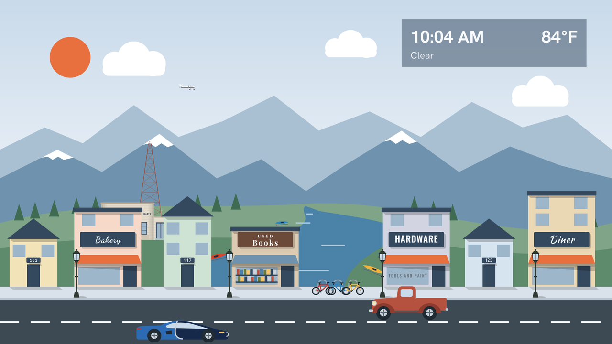

## Seasons

| Spring | Summer |
|---|---|
| 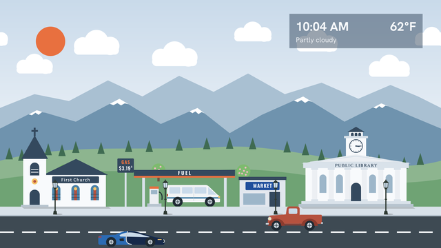 | 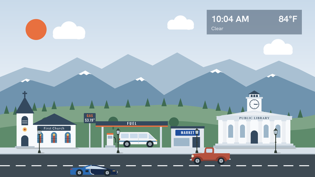 |
| **Fall** | **Winter** |
| 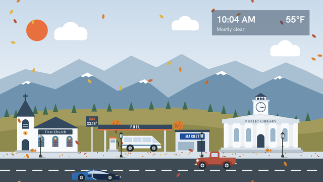 | 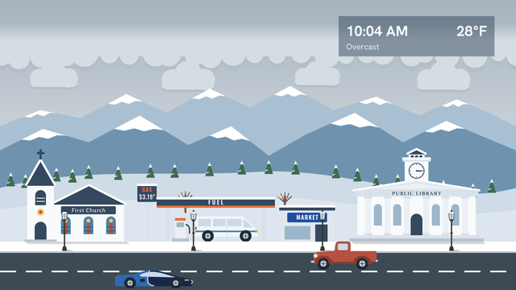 |

## Day, dusk, and night

| Day | Dusk | Night |
|---|---|---|
|  | 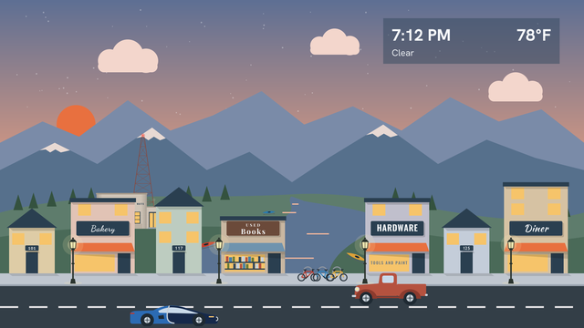 | 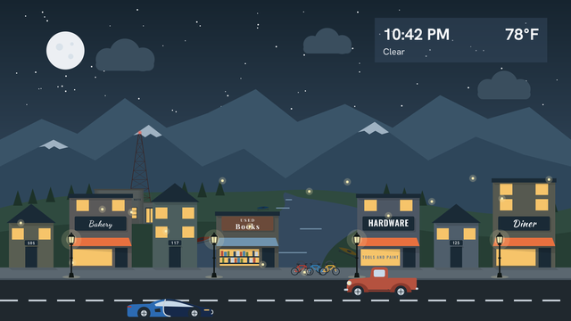 |

## The sample town

The `town.json` in this repository describes a sample town with four sections.

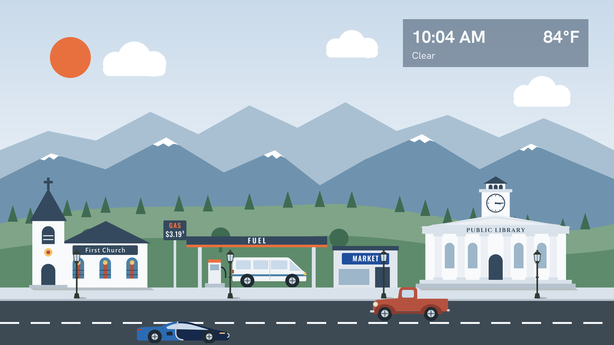

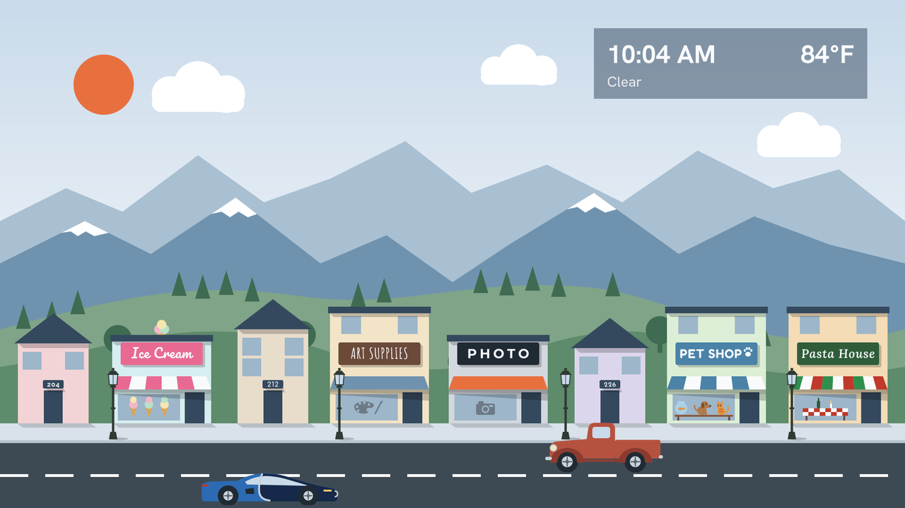

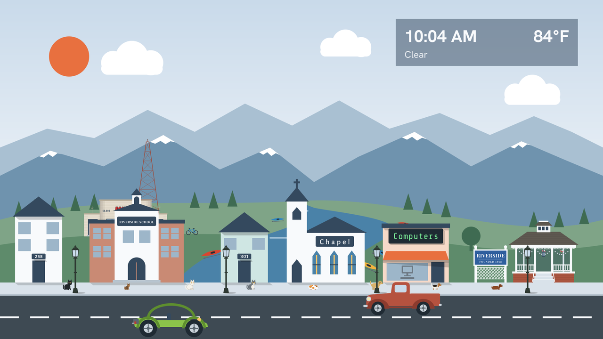

| Section D on a winter night |
|---|
| 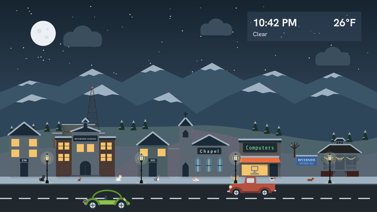 |

These images are drawn by `tools/generate_images.py` from the same artwork the screensaver uses. The animals are placed at random spots each time the screensaver starts, so they are in different places on the real screen.

## Features

- Five scenery layers that scroll at different speeds: clouds, far mountains, near mountains, hills with the river, and the town with the street. The far and near mountains each have two different images, so the mountains repeat only about every 13 minutes (far) and 5 minutes (near). As an option, the center far mountain can have a flat top, in the shape of Table Mountain in South Africa.
- A town of one to five sections, each 1920 pixels wide, built from the buildings in `town.json`. The buildings have different wall colors and heights, and each sign uses its own font. Like the rest of the scene, the colors are darker at dusk and night. Soft shadows under the awnings, roof edges, signs, and eaves, and on the sidewalk, give the buildings depth.
- A car parked at the gas station, if the town has one. The car and the direction it faces are chosen at random each time the screensaver starts.
- Six cars: a sports car in the style of a Bugatti, a sedan, a VW dune buggy with a green arch over the seats, a van, a Jeep, and an old truck. Each has its own speed, and the wheels spin at a rate that matches it. The sports car is the fastest. `town.json` can choose which cars drive by. It can also add special cars from movies: the Aston Martin DB5 from Goldfinger, Herbie (the Love Bug), KITT from Knight Rider, the Ecto-1 from Ghostbusters, the DeLorean time machine from the first Back to the Future movie, Lightning McQueen from Cars, and the 1969 Mustang Mach 1 from John Wick. Each special car has its own wheels. Special cars drive by less often than the other cars, about once every 20 seconds to 1 minute each, and never park at the gas station.
- As options: bikes in bike racks, two bikes parked beside the radio station, old-fashioned street lights that light up at dusk and night, and a radio station on the hill beside the river, with a tall red tower whose light blinks at dusk and night.
- Cats, dogs, and guinea pigs on the sidewalk, chosen in `town.json`. Cats come in five colors and two sizes, and there are eight kinds of dogs. They are placed at random spots each time the screensaver starts.
- Two lanes. The near lane draws the cars at full size, and the far lane draws them slightly smaller. Cars drive on the right by default, so the near lane drives left to right and the far lane right to left. `drive_on` in `town.json` can make them drive on the left instead. Only one car uses a lane at a time, and after a car leaves the screen, its lane stays empty for a random 1 to 10 seconds.
- A small Cessna airplane flies across the sky about every 1 to 3 minutes, in either direction. It flies at the distance of the far mountains, so it is small and its speed matches that distance: it takes about 17 seconds to cross the screen. At dusk and night its wingtip light is on, green when it flies right and red when it flies left, as on a real plane (green is on the right wingtip and red on the left). A white tail light blinks. At night both lights are brighter, with a wider glow. It does not fly in rain, snow, fog, or thunderstorms.
- Weather from [Open-Meteo](https://open-meteo.com/), refreshed every 15 minutes, in Fahrenheit or Celsius. No API key is needed.
- A 12 hour or 24 hour clock.
- Day, dusk, and night versions of the scene, chosen from today's real sunrise and sunset times.
- Four seasons, chosen from today's date:

  | Season | Dates (northern hemisphere) | What changes |
  |---|---|---|
  | Spring | March 20 to June 20 | Light green hills, trees with pink blossoms, flower boxes under house windows |
  | Summer | June 21 to September 21 | Green hills and trees, fireflies at night |
  | Fall | September 22 to December 20 | Gold hills, orange and red trees, pumpkins by doors, leaves on the sidewalk, falling leaves |
  | Winter | December 21 to March 19 | Snow on the hills, mountains, roofs, sidewalk, and pine trees, bare trees, a frozen river |

  The dates are close to the equinoxes and solstices, which move by a day or so from year to year. In the southern hemisphere, the seasons are the other way around. Pine trees stay green all year. There is one river, and in every season but winter, eight kayaks in different colors sit on the grass on both sides of it.
- Weather effects from the current weather:
  - Clouds: the number of clouds follows the cloud cover from the weather, in percent. Below 25 percent there are a few clouds, from 25 percent there are more, from 50 percent there are many larger clouds with gray undersides, and from 85 percent the sky is overcast: a gray layer of cloud covers the top of the sky, the sky is gray, the stars are hidden, and the sun and moon are dim. The weather code also sets the fewest clouds that can show, so the sky matches the text in the panel: "Partly cloudy" shows at least the second level, fog and showers at least the third, and "Overcast", drizzle, rain, snow, and thunderstorms show an overcast sky.
  - Rain and drizzle: falling rain.
  - Snow: falling snow. While snow is falling, the ground shows snow in any season.
  - Fog: a fog layer over the scene.
  - Thunderstorms: rain and lightning flashes at random times.

  Falling leaves and fireflies are hidden while rain or snow is falling. In fall the leaves do not fall all the time: they fall, fade out, stay hidden, then fade back in. Each of these lasts a random length of time.
- A clock and weather panel in the top-right corner. Every 5 minutes it fades out, moves a small amount within the corner, and fades back in, to protect TVs from burn-in. The sun and moon are in the top-left corner, so the panel never covers them.

## Make your own town

There are three ways to build a town from your own `town.json`. All three give the same result: a zip file of the screensaver, which you install on your Roku (see [Installing on a Roku](#installing-on-a-roku)), and preview images of your town.

### With GitHub, in a web browser

This needs only a GitHub account.

1. Go to [rorpage/riverside-town-sample](https://github.com/rorpage/riverside-town-sample) and click **Use this template**, then **Create a new repository**.
2. In your new repository, open `town.json`, click the pencil icon to edit it, and change it to describe your town. The [town.json reference](#townjson-reference) below lists every field.
3. Click **Commit changes**. GitHub builds your town. This takes about a minute.
4. Open the **Actions** tab, click the latest run of **Build my town**, and look at the bottom of the page. There are two downloads:
   - **riverside-town-roku**: the screensaver. It downloads as `riverside-town-roku.zip`, which you upload to the Roku as it is. Do not unzip it.
   - **riverside-town-previews**: a zip file of preview images of your town.

If something in `town.json` is wrong, the run fails, and its log names the field and says what is wrong.

The workflow in the template repository uses the `rorpage/riverside-town@v1` action:

```yaml
- uses: rorpage/riverside-town@v1
  with:
    config: town.json
- uses: actions/upload-artifact@v4
  with:
    name: riverside-town-roku
    path: out/roku/
- uses: actions/upload-artifact@v4
  with:
    name: riverside-town-previews
    path: out/previews/
```

GitHub puts each download in a zip file. `out/roku/` holds the screensaver files without a zip, so the zip that GitHub makes has the manifest at the top level, which is what the Roku needs.

### With Docker

Run this in a folder that has a `town.json`:

```
docker run --rm -v "$PWD:/work" ghcr.io/rorpage/riverside-town-roku-generator:1
```

It writes `out/riverside-town.zip`, the same files without a zip in `out/roku`, and the preview images in `out/previews`.

### With Python

From the root of this repository:

```
pip install cairosvg pillow fonttools jsonschema
python3 tools/build_town.py --config path/to/town.json --out out
```

See [Changing the artwork](#changing-the-artwork) for the requirements.

### Business names

You can give a shop any name, including the name of a real business. Real business names and logos can be trademarks. A town with real business names is for your own personal use. Do not sell it or publish it as a product.

## town.json reference

`town.json` is a JSON file. `tools/riverside/town.schema.json` describes every field. Editors such as VS Code use it to suggest field names and point out mistakes while you type, if the first line of `town.json` is:

```json
"$schema": "https://raw.githubusercontent.com/rorpage/riverside-town/main/tools/riverside/town.schema.json",
```

Only `location` is required. The [town.json](town.json) in this repository is a complete example.

| Field | What it sets | Default |
|---|---|---|
| `title` | The screensaver name in Settings > Theme > Screensavers | `"Riverside Town"` |
| `location` | Where the weather comes from: `{ "zip": "46204", "country": "US" }`, or `{ "lat": 39.7684, "lon": -86.1581 }`. For a ZIP or postal code, the build looks up the coordinates. If both are given, the coordinates are used. | required |
| `units.temperature` | `"F"` or `"C"` | `"F"` |
| `units.clock` | `"12h"` or `"24h"` | `"12h"` |
| `hemisphere` | `"north"` or `"south"`. In the south, the seasons are the other way around. | `"north"` |
| `drive_on` | Which side of the road cars drive on: `"right"` (as in the United States) or `"left"` (as in the United Kingdom). With `"right"`, cars in the near lane drive from left to right; with `"left"`, from right to left. | `"right"` |
| `buildings` | The buildings along the street, from left to right. See below. | none |
| `houses` | House numbers to spread out between the buildings, for example `["12", "14", "16"]` | none |
| `radio_station` | A radio station on the hill beside the river, smaller than the town buildings, like the kayaks. It is a 1940s brick broadcast building with a rounded center, a wall of windows, a door on each side, and antennas, with a tall, thin red lattice tower behind its right side. The light on top of the tower blinks at dusk and night, like the airplane's tail light. The call letters are slanted red letters with a black outline and shadow. Like the WSQK logo, the first Q is drawn as an O with a lightning bolt for its tail. It is an object with `name` (the call letters, required), `small_line` (a line in script below them, for example `"The Squawk"`), `power` (shown as "50,000 WATTS" on each side of the call letters), `letter_color`, `color` (the brick), and `tower` (default `true`). | none |
| `pets` | Animals on the sidewalk, for example `{ "type": "cat", "color": "tabby", "size": "small" }`. Cats can be `"black"`, `"gray"` (dark gray with darker stripes, drawn a little darker at night so it shows against the sidewalk), `"tabby"`, `"white"`, or `"gray_white"` (gray with a white chest, muzzle, and paws). Dogs (`"dog"`) can be `"yellow_lab"`, `"black_lab"`, `"chocolate_lab"`, `"beagle"`, `"corgi"`, `"dalmatian"`, `"dachshund"`, or `"husky"`. Guinea pigs (`"guinea_pig"`) can be `"black_orange"` or `"white_orange"`. `size` is `"regular"` (the default) or `"small"`, which is 0.65 times as big. Up to 10. | none |
| `cars` | Which cars drive by: `"sedan"`, `"van"`, `"jeep"`, `"truck"`, `"sports"`, and `"buggy"`. At least 2. | all six |
| `special_cars` | Special cars from movies: `"aston"` (the silver Aston Martin DB5 from Goldfinger), `"herbie"` (Herbie, the Love Bug: a pearl white 1963 VW Beetle with the number 53 on the door), `"kitt"` (KITT from Knight Rider: a black 1982 Pontiac Trans Am with a red scanner light on the nose), `"ecto1"` (the Ecto-1 from Ghostbusters: a white and red 1959 Cadillac ambulance with equipment on the roof), `"delorean"` (the DeLorean time machine from the first Back to the Future movie), `"mcqueen"` (Lightning McQueen from Cars: a red race car with the number 95), and `"mustang"` (the dark gray 1969 Ford Mustang Mach 1 from John Wick). Each one first drives by 6 to 25 seconds after the screensaver starts, then about once every 20 seconds to 1 minute. Special cars never park at the gas station. | none |
| `extras.airplane` | The airplane | `true` |
| `extras.kayaks` | The kayaks beside the river | `true` |
| `extras.fireflies` | Fireflies on summer nights | `true` |
| `extras.falling_leaves` | Falling leaves in fall | `true` |
| `extras.seasons` | Seasons from the date. When it is `false`, it is always summer, but snow still shows while it is snowing. | `true` |
| `extras.table_mountain` | A flat-topped mountain in the shape of Table Mountain, in the center of the far mountains | `false` |
| `extras.bikes` | Two bikes parked beside the radio station (not in winter). Bike racks have bikes either way. | `false` |
| `extras.street_lights` | Old-fashioned cast iron street lights along the sidewalk, about 480 pixels apart. A light moves to the side when it would cover a house number. Animals walk behind the lights. Their lanterns light up at dusk and night. | `false` |

### Buildings

Each entry in `buildings` is a building with a `type`. A house can also be written as just its number, for example `"101"`.

The buildings are placed in order, with a space of at least 28 pixels between them (12 pixels if 28 would need another section), and the room that is left in a section is shared out between the spaces, so more of the hills and the river shows between the buildings. When the next building does not fit in the current 1920 pixel section, it starts the next section. `{ "type": "section_break" }` starts a new section on purpose. To spread out the buildings in a full section, move a `section_break` so some of its buildings go to a section with more room. Up to 3 trees, in different sizes, stand in the space left at the end of a section. The town can have up to 5 sections, because each section uses about 4 MB of memory on the Roku. If the buildings do not fit, the build stops and says how many to remove.

These options work for most types:

| Option | What it sets |
|---|---|
| `name` | The name on the sign. Long names are made smaller to fit. A straight apostrophe (`'`) is drawn as a curly one. |
| `color` | The wall color, as `"#RRGGBB"`, in daylight. It is darker at dusk and night. Without it, the building gets a color from a set of colors that look good together. |
| `font` and `weight` | The font for the sign, from the [font list](#fonts), and its weight from 100 (thin) to 900 (black). Fonts with one weight ignore `weight`. |
| `sign_size` | The largest text size on the sign |

| Type | What it is | Its own options |
|---|---|---|
| `house` | A house with a pointed roof and its number above the door | `number` (required), `stories` (1 or 2), `width` (110 to 260 pixels, default 150). Without a `font`, each house gets a different one. |
| `shop` | A shop with a sign, an awning, and a display window | `stories` (1, 2, or 3), `width` (160 to 400, default 210), `small_line` (a small line above the name), `sign_color`, `sign_text_color`, `sign_icon` (`"paw"`), `letter_spacing`, `awning` (`"plain"`, `"striped"`, or `"none"`), `awning_color`, `awning_colors` (2 to 4 stripe colors), `window`, `window_lettering` (gray letters on the window; `\n` starts a second line), `roof_icon` (`"ice_cream"`) |
| `bakery`, `bookstore`, `diner`, `computer_store`, `ice_cream`, `art_store`, `photo_store`, `pet_shop`, `restaurant` | A shop with a font, colors, and window already chosen. Any shop option changes them. | the shop options |
| `church` | A church | `style` (`"steeple"`: a bell tower with a spire; `"tower"`: a stone church with a square tower), `cross` (default `true`) |
| `school` | A two-story school with the name over the door | `cross`, `bell_tower`, `width` (240 to 480, default 300) |
| `columned_hall` | A stone building with columns and steps, like a library or a courthouse, with the name across the top | `clock` (a clock tower), `clock_time` (for example `"10:04"`), `letter_color`, `letter_outline` |
| `gas_station` | A price sign, a canopy over one pump, and a small store. A car is parked under the canopy. | `canopy_name` (default `"FUEL STOP"`), `store_name` (default `"MARKET"`), `store_sign_color`, `price` (for example `"3.19"`; a small 9 is added for the 9/10 of a cent) |
| `drive_through` | A restaurant with its name on a colored roof and a drive-through window | `roof_color`, `sign_text_color` |
| `gazebo` | An eight-sided gazebo on a brick base, with a shingled roof, a cupola, white posts and railings, and front steps. It has hanging flower baskets in spring and summer, leaf garlands, corn stalks, hay, and pumpkins in fall, and wreaths in winter. Strings of bulbs hang between the posts, with a lantern in the middle, and they are lit at dusk and night. | `name` (a town sign stands to its left, with this name), `small_line` (a small line on the sign, for example `"FOUNDED \u00b7 1779"`), `sign_color`, `color` (the brick base) |
| `bike_rack` | A bike rack on the sidewalk with three bikes | none |
| `tree` | A tree | none |
| `section_break` | Starts a new town section | none |

`window` choices for shops: `"books"` (rows of book spines), `"computer"`, `"camera"`, `"palette"` (a painter's palette), `"ice_cream"` (three cones), `"pets"` (a fish bowl, a puppy, and a kitten on a table), `"table"` (a table with a checkered tablecloth), or `"none"`.

### Fonts

The `font` value is one of these names:

| Name | Font | Name | Font |
|---|---|---|---|
| `alegreya` | Alegreya Sans (Medium only) | `kaushan` | Kaushan Script (one weight) |
| `amatic` | Amatic SC (Bold only) | `lora` | Lora Italic |
| `bitter` | Bitter | `montserrat` | Montserrat |
| `cabin` | Cabin | `oswald` | Oswald |
| `cinzel` | Cinzel | `pacifico` | Pacifico (one weight) |
| `comfortaa` | Comfortaa | `playfair` | Playfair Display |
| `fredoka` | Fredoka | `quicksand` | Quicksand |
| `graduate` | Graduate (one weight) | `raleway` | Raleway |
| `hanken` | Hanken Grotesk | `script` | Dancing Script |
| `josefin` | Josefin Sans | `racing` | Racing Sans One (one weight; the radio station call letters) |
| `sharetech` | Share Tech Mono (one weight) | `signika` | Signika |

If a font cannot draw a letter in a name, the build stops and names the letter.

These fonts are from [Google Fonts](https://fonts.google.com/), under the SIL Open Font License. The license for each font is in `tools/fonts` next to the font file. The fonts are used only by the generator and are not part of the Roku zip.

## Project layout

```
manifest                         Roku channel manifest (the generator writes the title)
town.json                        The sample town
build.sh                         Builds riverside-town.zip and installs it on a Roku
source/main.brs                  Entry point (RunScreenSaver)
components/MainScene.xml         Scene layout: layers, lanes, panel, animations
components/MainScene.brs         Scene logic: parallax, cars, clock, weather, time of day
components/WeatherTask.xml       Task node definition for the weather request
components/WeatherTask.brs       Calls the Open-Meteo API
components/town_config.json      The town's settings for the screensaver, written by the generator
images/                          All artwork as PNG files, written by the generator
tools/generate_images.py         Draws every image in images/ from town.json
tools/build_town.py              Builds a complete zip and previews from any town.json (used by Docker)
tools/riverside/                 The generator's code: building types, layout, scenery, and town.schema.json
tools/fonts/                     Sign fonts and their licenses (used only by the generator)
Dockerfile                       The riverside-town-roku-generator image
action.yml                       The GitHub Action that runs the image
.github/workflows/               Publishes the image when a version tag is pushed
docs/                            Preview images for this README, and customization-plan.md (not part of the Roku zip)
```

## Installing on a Roku

1. Turn on developer mode on the Roku. On the remote, press Home 3 times, Up 2 times, then Right, Left, Right, Left, Right. Follow the steps on screen and set a password.
2. Install the zip. There are two ways:
   - **Install with the web page.** In a web browser, go to `http://<roku-ip-address>`, sign in with the username `rokudev` and your password, and upload the zip file (`riverside-town.zip`, or `riverside-town-roku.zip` from GitHub).
   - **Install from the script.** To install the sample town in this repository, run this from the repository root, with the Roku's IP address:
     ```
     ROKU_DEV_TARGET=<roku-ip-address> ./build.sh
     ```
     The script checks that the Roku responds, builds `riverside-town.zip`, asks for the developer password, and uploads the zip to the Roku. Run `./build.sh --zip-only` to only build the zip. If you cannot run the script, run this from the repository root instead:
     ```
     zip -r riverside-town.zip manifest source components images -x "*.DS_Store"
     ```
   Either way, the zip contains only the files the Roku needs, with the manifest at the top level.
3. On the Roku, go to Settings > Theme > Screensavers and choose Riverside Town (or the `title` from your `town.json`).

Because a screensaver cannot be opened from the home screen, use the Preview option in Settings > Theme > Screensavers to see it without waiting for the Roku to go idle.

Developer mode allows only one sideloaded channel at a time. Installing this screensaver replaces any other sideloaded channel on the same Roku.

## Settings in the code

The settings that are not in `town.json` are at the top of `init()` in `components/MainScene.brs`.

| Setting | What it controls |
|---|---|
| `m.layerSpeeds` | Scroll speed of each scenery layer, in pixels per second. |
| `m.layerWidths` | Width of each scenery layer before it repeats. The far and near mountains are 3840 because each is two different 1920 pixel images. The hills are 5760 because they are three. The town is 1920 times the number of town sections. |
| `m.cameraSpeed` | Must match the `town` layer speed. Cars use it so their speed looks correct relative to the street. |
| `allCars` | Each car's image size, wheel positions, wheel radius, and `ground` speed in pixels per second. `m.carDefs` holds the ones `town.json` turns on. |
| `m.planeSpeed` | The airplane's own speed at the distance of the far mountains, in pixels per second. The comment above it in `MainScene.brs` shows how it was worked out. |
| `m.planeWaitMin`, `m.planeWaitMore` | Seconds between airplane flights: at least `m.planeWaitMin`, plus a random amount up to `m.planeWaitMore`. |
| `m.leafOnMin`, `m.leafOnMore`, `m.leafOffMin`, `m.leafOffMore` | How long the fall leaves fall and how long they stop, in seconds: at least the `Min` value, plus a random amount up to the `More` value. The defaults are 25 to 70 seconds falling and 15 to 60 seconds stopped. |
| `m.infoSpots` | The positions the clock panel moves between. They are all in the top-right corner. |
| `m.seasonOverride` | Set to `"spring"`, `"summer"`, `"fall"`, or `"winter"` to always show that season, for example to preview it. Leave it as `""` to choose the season from the date. |
| `m.seasonalLayers` | Which scenery layers have a different image for some seasons. It must match `SEASONAL` in `tools/generate_images.py`. |

The panel's transparency is set by the `color` value on the `Rectangle` inside the `info` group in `components/MainScene.xml`. The last two characters are the opacity: `00` is fully clear and `FF` is fully solid.

## Changing the artwork

The images are drawn by `tools/generate_images.py` and the code in `tools/riverside/`. Edit `town.json`, or the shapes and colors in the code, then regenerate:

```
pip install cairosvg pillow fonttools jsonschema
python3 tools/generate_images.py --docs docs
```

Requirements:

- Python 3.
- The Cairo graphics library, which `cairosvg` needs. On macOS, install it with `brew install cairo`. On Debian or Ubuntu, install it with `sudo apt install libcairo2`.
- No fonts need to be installed. The sign fonts are in `tools/fonts`, and the generator converts the sign text to shapes, so the images are the same on every computer.
- An internet connection only if `town.json` has a ZIP code without coordinates.

The generator writes:

- every PNG into `images/`, including the mirrored car images used by the far lane
- `components/town_config.json`, the settings the screensaver reads: the coordinates, units, number of town sections, cars, animals, extras, and where the gas station is
- the title into `manifest`
- full-scene previews into `build/`, which git ignores: one for each town section, season, and day and night (`composite_<season>_<period>_<section>.png`). The summer previews include the parked car so its position can be checked.
- the preview images for this README into `docs/`, when `--docs docs` is given

Where each part of the drawing is:

| File | What it draws |
|---|---|
| `tools/riverside/art.py` | Palettes, season colors, fonts and text, and small details such as snow, pumpkins, flower boxes, and trees |
| `tools/riverside/scenery.py` | The sky, clouds, mountains, hills, river, and street |
| `tools/riverside/buildings.py` | Every building type |
| `tools/riverside/layout.py` | Places the buildings in town sections |
| `tools/riverside/config.py` | Reads and checks `town.json`, and fills in defaults |
| `tools/riverside/sprites.py` | The cars, animals, airplane, sun, moon, stars, and weather effects |
| `tools/riverside/movie_cars.py` | The special cars from movies and their wheels |
| `tools/riverside/previews.py` | The preview images |

Notes on the image sizes:

- Each scenery layer is exactly 1920 pixels wide and its left and right edges line up, so two copies placed side by side repeat without a visible seam. The town layer is one image for each town section (`town_a` to `town_e`). The screensaver places them in order, then the first one again, so the street repeats without a jump.
- The sky is an 8 pixel wide gradient that the scene stretches to full width. This uses much less memory than a full-size image. The fog image works the same way.
- The hills are three different images, `hills`, `hills_b`, and `hills_c`, placed in the order A, B, C, A, so they repeat every 5760 pixels. Only the first has the radio station. The third has its own hill shapes, more trees, and no river.
- Seasonal layers are named `<layer>_<season>_<period>.png`, for example `hills_fall_night.png`. The hills and the town sections have an image for every season. The far and near mountains only have a winter image (`far_winter_day.png`); in other seasons they use the image without a season in the name (`far_day.png`). The clouds and sky do not change with the seasons. The clouds have one image for each cloud level, named `clouds_<level>_<period>.png` (`few`, `scattered`, `broken`, and `overcast`), and the overcast sky is `sky_overcast_<period>.png`.
- The generator deletes the old images before it writes new ones, so files that are no longer used do not stay in `images/`.

## Adding features and releasing

New features are made in this repository. Other towns get them when a new version is published.

### 1. Make the change

Make the change on a branch named `feature/<short-name>`, open a pull request, and merge it into `main`. If the feature adds a `town.json` field or option, also:

- add it to `tools/riverside/town.schema.json`
- add its default to `tools/riverside/config.py`
- add it to the [town.json reference](#townjson-reference) in this README
- regenerate the previews with `python3 tools/generate_images.py --docs docs`

### 2. Test it before publishing

The GitHub Action always runs the published Docker image, not the code on a branch, so a branch cannot be tested with the "Build my town" workflow. Test it on your computer instead, with any `town.json`:

```
python3 tools/build_town.py --config path/to/town.json --out out
```

This builds the same zip that the Action builds, in `out/riverside-town.zip`. Install it with the Roku developer web page (see [Installing on a Roku](#installing-on-a-roku)).

### 3. Publish a new version

After the pull request is merged, push a version tag from `main`:

```
git checkout main
git pull
git tag v1.1.0
git push origin v1.1.0
```

You can also create a release on GitHub instead: on the **Releases** page, click **Draft a new release**, type the new tag, choose `main` as the target, and click **Publish release**.

Choose the version number from the kind of change:

| Kind of change | Example | Tag |
|---|---|---|
| A fix that changes nothing for users | a drawing mistake | `v1.0.1` |
| A new feature that existing `town.json` files do not need | a new building type or a new pet | `v1.1.0` |
| A change that makes existing `town.json` files fail | a field is renamed or removed | `v2.0.0` |

The tag starts `.github/workflows/riverside-town-roku-generator.yml`. It builds the Docker image and publishes it to the GitHub Container Registry as `ghcr.io/rorpage/riverside-town-roku-generator`, with the tags `1.1.0`, `1.1`, `1`, and `latest`. Then it moves the git tag `v1` to the same commit. The next "Build my town" run in any repository that uses `rorpage/riverside-town@v1` uses the new version, with no change in that repository.

For a new major version, such as `v2.0.0`, first change the image in `action.yml` from `:1` to `:2` in the pull request. The workflow then creates the `v2` tag. Repositories that use `@v1` keep the old version until their workflow is changed to `@v2` and their `town.json` is updated.

The image package must be public, so that anyone can download it without signing in. This is set once, in the package settings on GitHub, and stays set for new versions.

### 4. Rebuild the towns

- If the new feature needs settings, add them to the town's `town.json`. Committing the change starts a build.
- If it needs no settings, open **Actions**, then **Build my town**, then **Run workflow**, to rebuild with the new version.
- Keep the `town.json` in [riverside-town-sample](https://github.com/rorpage/riverside-town-sample) the same as the one in this repository, except that the sample repository uses a ZIP code, so the template shows the new features.

## Debugging

Connect to the screensaver's debug console with:

```
telnet <roku-ip-address> 8087
```

Screensavers use port 8087, not port 8085 like normal channels. Errors from the weather request are printed there with the prefix `WeatherTask:`. If `components/town_config.json` cannot be read, a message is printed with the prefix `MainScene:`, and the screensaver uses default settings.

## Known limits

- A screensaver cannot define `Main()`. If it does, Roku does not list it under Settings > Theme > Screensavers. For this reason it cannot be opened from the home screen.
- Only one car uses each lane at a time, so at most two moving cars are on screen.
- Dusk covers 40 minutes on each side of sunrise and sunset. Before the first weather request finishes, the scene assumes sunrise at 7:00 AM and sunset at 7:00 PM.
- New building types and new animals need Python code in the generator. `town.json` can only choose from the types that exist.

## License

The code and artwork in this repository are released into the public domain under [The Unlicense](LICENSE). You can copy, change, and share them for any purpose, without asking.

The fonts in `tools/fonts` are not covered by this license. Each font has its own license file next to it, the SIL Open Font License, which allows using and sharing the fonts.

## Credits

Weather data is provided by [Open-Meteo](https://open-meteo.com/). The free Open-Meteo API is for non-commercial use and its data requires attribution. Check the Open-Meteo terms before using this project for anything commercial.
